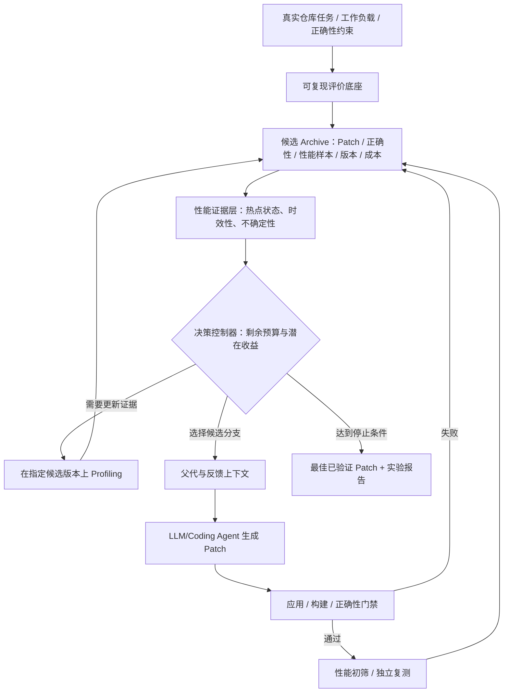

# 硕士论文创新点候选与推荐选题方案（V1）

> **定位**：开题研究备忘录 / 可迭代选题决策文档（并非最终开题报告）  
> **整理日期**：2026-11-10  
> **适用背景**：中国科学技术大学计算机科学与技术学院，2025 级，计算机技术（085404）专业学位硕士。  
> **研究主线**：面向真实软件仓库的自主代码性能优化 Agent。  
> **资料来源**：以此前关于“我们所能够采用的创新点都有哪些？要足够支撑我的硕士毕业论文”的讨论及四篇论文精读为基础进行综合整理。本文**没有声称重新完成全部相关工作的系统性查新或复现实验**，所有创新点均待查新与验证。

---

## 0. 执行摘要：当前最推荐的方向

**暂定论文题目（首选）**：

> **《面向真实软件仓库的性能证据驱动的自主代码优化方法研究与系统实现》**

**核心研究问题**：面对多个代码优化候选及不断变化的程序运行热点，Agent 如何在有限预算下决定**何时更新性能证据、继续优化哪个候选、何时切换分支或停止**，以提升可信的端到端性能收益？

**推荐的创新点组合**：

1. **B：版本感知的性能证据建模与按需 Profiling（主方法的状态与观测层）**。性能画像绑定 *代码版本 + 工作负载 + 环境*；识别证据过时与瓶颈迁移，选择合适的重新分析时机。
2. **A：性能证据感知的多候选分支选择（主方法的搜索决策层）**。结合候选的性能、热点、历史尝试、证据可信度及分支多样性，决定下一次从哪个候选产生子代。
3. **C 的受限部分：预算与测量不确定性约束（横贯 A/B 的控制条件）**。把 LLM、Profiling、Benchmark/复测成本纳入决策；**不必单独开发一套宏大的全局预算优化算法**。

三者构成一条统一主线：**性能状态获取与更新 → 基于状态决定搜索动作 → 以固定预算及独立性能验证检验价值**。建议把 A+B 作为一个紧密关联的核心方法研究，而非人为拆成多个彼此孤立的“创新点”。

**专业硕士论文成果形式建议**：一个可运行、可复现的 Agent 原型系统 + 一个明确且有实证支持的核心方法 + 完整的比较/消融/成本分析 + 真实软件任务上的工程验证。**不保证自动满足学校具体毕业要求**；以适用培养方案、学院细则和导师意见为准。

---

## 1. 研究背景：四篇论文分别给了我们什么

| 论文 | 研究角色 | 已有能力/成果 | 我们应该借鉴什么 | 不能误称为什么 |
|---|---|---|---|---|
| **SWE-Perf** | 真实性能优化评测基准 | 真实历史优化任务、正确性与性能评测、Agent/模型比较 | 独立评价、重复测量、正确性门禁、真实任务 | 不是作者提出的全新专用优化 Agent |
| **PerfAgent** | 性能反馈型优化工作流 | 现有 Coding Agent + Profiler + 外部多轮控制 | 运行证据、反馈、保留最佳正确 Patch | 不是只要多跑几轮就一定更好 |
| **ShinkaEvolve** | 进化式程序搜索框架 | Archive、父代采样、候选历史、新颖性与评估 | 多分支搜索、探索/利用平衡、候选保存 | 不是专门解决仓库级性能测量可信性的框架 |
| **AlphaEvolve** | 通用算法发现型进化 Agent | 程序数据库、历史上下文、评价级联、算法搜索 | 自动评价、分层成本控制、受控多组件修改 | 不是所有任务都能直接迁移其数学/工程成果 |

**主要矛盾**：PerfAgent 风格的反馈通常强调“怎样改进当前代码”，进化搜索强调“从哪个历史候选继续尝试”。二者并不互斥，但仅仅把它们串联起来，不是充分的创新。

我们要研究的可能是它们之间更深的**协同决策**：同一候选上的性能证据会随代码修改而变化；不同候选的瓶颈不一定相同；Profiling 和完整 Benchmark 都有成本。如何利用这些信息选择分支与下一次动作，才是候选创新的切入点。

---

## 2. 功能点、方法点与可成立创新点的区别

| 计划做的事 | 当前定位 | 原因 |
|---|---|---|
| 调用 LLM/Codex 改代码 | 工程基础 | 现成工具能力 |
| 增加 Profiler、反馈迭代 | 已有方法的工程复用 | 与 PerfAgent 等研究有重叠 |
| 保存多个 Patch、选父代 | 已有进化搜索机制 | 与 ShinkaEvolve、AlphaEvolve 等研究有重叠 |
| 用 MCTS/UCB/Bandit 分配预算 | 通用已知算法组件 | 需要证明面向性能优化的专有差异 |
| 维护与代码版本及工作负载绑定的性能证据，并选择何时更新 | **候选方法贡献** | 若能提出新判定机制并证明显著收益，有研究价值 |
| 使用性能状态及证据置信度来决定继续/切换候选分支 | **候选方法贡献** | 必须与基于 fitness、历史收益、MCTS 等强基线区别开 |
| 统一正确性、端到端性能、预算的独立实验体系 | 系统与实验贡献 | 提供实证可信性，通常不是单独的算法创新 |

**判断标准**：是否提出了明确的新问题或新决策信息？是否实现了可重复的方法？与最接近的工作有什么可辨认的不同？是否能用对照与消融说明因果贡献？

---

## 3. 七个候选创新方向（A–G）

> 评估为当前项目的**研究优先级**，并非“学术新颖性已被证明”的评级。

| 编号 | 候选方向 | 核心问题 | 初步优先级 | 主要风险 |
|---|---|---|---|---|
| **A** | 性能证据感知的分支调度 | 下轮该优化哪个候选？ | **高** | 与运行时引导进化、MCTS 重叠 |
| **B** | 瓶颈迁移感知与按需 Profiling | 何时重新测热点？ | **高** | 证据过时判定可能不准确 |
| **C** | 预算约束下的搜索与评价协同 | 时间/Token 用于生成、Profiling 还是复测？ | 高 | 与 Bandit/预算调度重叠，设计复杂 |
| **D** | 自适应代码修改范围 | 改一个函数、相关函数还是模块？ | 中高 | 跨文件依赖、回归和验证成本高 |
| **E** | 跨工作负载鲁棒优化 | 如何避免固定输入上的性能过拟合？ | 高 | 代表性输入及独立测试集难构造 |
| **F** | 跨分支经验迁移 | 不同路线的优化思路怎样有效复用？ | 中高 | Inspiration/Crossover 已有大量工作 |
| **G** | 多目标优化 | 速度、内存、能耗如何权衡？ | 中 | Pareto 与多目标搜索已较成熟 |

### A. 性能证据感知的分支调度

**问题情境**：候选 P1 当前快，但其热点已多轮优化、收益停滞；P2 当前稍慢，却存在尚未探索的显著热点。若仅按当前执行时间选父代，可能错过 P2 的后续改进空间。

**可研究机制**：建立与候选版本绑定的状态，包括绝对耗时、热点结构、历史子代收益、分支访问次数、性能波动和剩余预算；使用这些证据辅助选择父代或决定继续/切换。

**需要证明**：在同预算下，优于 Best-of-N、始终选择当前最佳（Hill Climbing）、普通加权父代采样及可比的 UCB/MCTS 控制方法。**仅给 fitness 加权，不宜自称创新。**

### B. 瓶颈迁移与按需 Profiling

**问题情境**：优化 `parse()` 后，`compute()` 可能成为新热点；沿用旧画像会误导下一轮，但每个 Patch 都重新 Profiling 昂贵。

**可研究机制**：将性能画像绑定 `(commit/patch_id, workload_id, runtime_env)`；依据修改范围、热点涉及的调用链、端到端时间变化和证据不确定性，评估“旧画像可继续使用还是需要更新”。

**重要技术细节**：**热点百分比的升降不等于绝对运行时间的升降**。例如 `compute()` 占比上升，可能仅因 `parse()` 变快。判断迁移应同时利用绝对采样数据和端到端计时。

**需要证明**：相对“只首轮画像”“每轮画像”“每 K 轮画像”，在相同预算下减少过时反馈造成的无效搜索、降低 Profiling 成本或提高最终优化成功率。

### C. 预算感知的生成—分析—验证决策

**问题情境**：预算有限时，一次调用 LLM、一次 Profiler 或一次高精度 Benchmark 并不等价；当候选差距小于测量噪声时，复测可能比生成新 Patch 更有价值。

**候选动作**：`Generate / Profile / Reevaluate / SwitchBranch / Stop`。可综合预期性能收益、证据质量、动作开销及剩余预算决策。

**边界**：本课题优先将预算视为 A+B 的约束与对照指标；只有在实验显示“动作分配”本身产生显著收益时，才独立升格为方法研究。

### D. 自适应代码修改范围

研究是否应由 `Function → Related Functions → Module` 逐级扩大范围；可依据热点、调用图、历史失败、测试覆盖及回归风险进行调整。与现有图分析、跨粒度定位工作重叠较高；对最初系统而言工程成本大，适合后续扩展。

### E. 跨工作负载的鲁棒优化

研究如何避免仅在搜索用输入上变快、在新输入或大规模数据上退化。可采用搜索/验证工作负载分离、不同输入规模、最坏情况退化约束及稳健候选选择。这个方向可成为**备选主线**，尤其在 A+B 难以显示明显收益时。

### F. 跨分支经验迁移

将不同 Patch 的优化意图、影响函数、收益与失败记录结构化，并研究经验在何种代码依赖和工作负载条件下可以复用；不仅是把两份 Patch 拼接起来。需区分 ShinkaEvolve 的 Inspiration、Crossover 等已有设计。

### G. 多目标优化

在正确性前提下优化运行时间、内存、资源占用或能耗，保留 Pareto 候选。但若仅添加线性加权指标或现成 Pareto Archive，创新性有限；更适合工程场景扩展。

---

## 4. 选题组合比较与明确推荐

| 方案 | 主要内容 | 优点 | 风险 | 当前判断 |
|---|---|---|---|---|
| **方案 1：A+B，融入 C 的成本约束** | 版本感知性能状态 + 按需分析 + 证据引导候选搜索 | 研究问题统一，连接反馈与进化，适合系统和方法并举 | 与 CodeEvolve、预算进化等工作需认真区分 | **首选** |
| 方案 2：B+E | 动态性能证据更新 + 跨工作负载稳健优化 | 更容易突出可靠性，工程测试严谨 | 搜索调度创新相对减弱 | **重要备选** |
| 方案 3：C+E | 预算/不确定性感知复测 + 鲁棒候选选择 | 聚焦评测成本与真实性能，很适合工程型研究 | 需与多保真优化/序贯检验相关工作区分 | 次选 |
| 方案 4：A+D | 分支调度 + 自适应修改范围 | 与仓库级依赖结构联系较紧 | 工作量及回归风险高，创新边界较难建立 | 暂不首选 |
| 方案 5：F+G | 跨分支迁移 + 多目标搜索 | 功能展示丰富 | 方向分散、已有工作多 | 不建议作为唯一主线 |

### 推荐的研究命题

> **性能证据的时效性与充分性，会影响多候选代码优化 Agent 的分支选择；显式建模并按需更新这些证据，可能在相同端到端预算下提高正确优化的成功率与最终收益。**

这是**待验证假设**，不是结论。

**推荐的两层方法架构**：

1. **证据层（B）**：负责采集、绑定、评估、更新性能画像；区分实测事实、估计状态与过时标记。
2. **决策层（A + C 的成本约束）**：从多个正确候选中选择父代，决定下一步是否 Profiling、继续优化、换分支、复测或停止。

共享同一个 Archive，但不同候选原则上使用**各自对应版本与工作负载的运行证据**，不能把 P1 的画像直接当成 P2 的测量结果。

**为什么不仅仅是“组合已有模块”**：可重点研究 *Profiler 信息过期程度是否能预测优化失败或下一轮收益*，再研究 *将该信息引入动作与父代选择是否优于仅依据 fitness 的策略*。必须证明新增信息有独立价值，且投入成本合理。

---

## 5. 适合 2025 级 085404 专硕的论文题目备选

| 题目 | 适用情形 | 建议 |
|---|---|---|
| **《面向真实软件仓库的性能证据驱动的自主代码优化方法研究与系统实现》** | 方法仍有调整空间，适合现阶段讨论导师 | **当前首选** |
| 《基于动态性能反馈与多候选搜索的自主代码优化方法研究》 | A+B 已经过实验证明、强调方法 | 论文后期可收敛为此 |
| 《面向真实软件仓库的性能证据感知搜索决策方法及 Agent 系统实现》 | 搜索控制器成为明确创新核心 | 最终方法确定后再考虑 |
| 《面向多工作负载的鲁棒代码性能优化 Agent 设计与实现》 | 若转向 B+E，突出稳健性能 | 备选方向切换时使用 |

**题目选择原则**：现阶段不在题目中写死未验证的“自适应 MCTS”“新型 Bandit”等具体算法；等查新、原型和初步实验完成后再收紧。不可因为想体现创新而预设算法必须优于所有基线。

---

## 6. 毕业论文拟形成的贡献结构（按证据强弱表述）

### 贡献 1：系统与评测基础

构建面向真实仓库的优化 Agent 原型，支持任务版本恢复、隔离 Patch 执行、正确性测试、重复性能测量、候选历史与成本追踪。该项是**工程与可复现性贡献**，一般不是主要算法创新。

### 贡献 2：候选核心方法（论文重点）

研究面向不同代码版本与工作负载的性能证据表示和更新策略，并将其用于多候选搜索决策。应形成**明确算法/规则/状态定义和可证伪的研究假设**，而不只是实现数据库字段或连接已有 API。

### 贡献 3：实验分析与工程验证

在真实优化任务上报告与已有方法的可比实验、消融、跨预算、成本和失败案例分析；有条件时扩展到 C++ / 并行程序或 ParaLedger，说明方法适用边界。ParaLedger 是**潜在验证场景**，不是本课题唯一对象。

> **学位要求边界**：上述结构针对工程技术深度和论文完整性提出建议，不保证已满足中国科大 2025 级计算机技术专业学位的所有学位与成果条件；最终以培养方案、学院要求与导师认定为准。

---

## 7. 最小 Agent 系统演进路线（V0–V5）

| 版本 | 要实现的最小能力 | 验收重点 | 科研角色 |
|---|---|---|---|
| **V0：可信评价器** | 指定 original + Patch，自动应用、构建、测试、重复测量、还原、记录 | 错误 Patch 会被拒绝；噪声与版本可追溯 | 所有实验基础 |
| **V1：One-shot Agent** | 单次 Coding Agent 生成 Patch → V0 评价 | 能独立完成真实任务并记录成本 | 最低基线 |
| **V2：多轮反馈** | 当前最优正确候选继续优化、按测试反馈迭代 | 保留 best correct，处理回退和停止 | 单路径基线 |
| **V3：Profiler** | 画像生成、结构化热点摘要、版本关联 | 有/无 Profiler 可对照 | B 的基础 |
| **V4：多候选 Archive** | 多父代、分支历史、Best-of-N / Hill Climbing / 简单 Archive | 共同评价器、可比预算 | A 的基础与强基线 |
| **V5：研究方法** | 动态证据更新 + 证据感知分支决策；可按需加入动作预算 | 系统性比较、消融、独立复测 | 候选核心贡献 |

**不能跳过 V0**。如果评测环境不稳定，后续搜索策略的实验结论难以成立。V2–V5 是路线图，**不是当前立即交给 Codex 全部实现的授权**。

---

## 8. 必做的对照、消融与结果指标

### 8.1 基线（先易后难）

1. One-shot Coding Agent。
2. 同预算 Best-of-N（多个独立候选）。
3. 多轮反馈/PerfAgent-style（若并非复现原版，明确标注 *-style*）。
4. Hill Climbing：永远从当前最佳正确候选继续优化。
5. 普通 Archive 父代选择 / ShinkaEvolve-style。
6. 在可实施时增加可比的 UCB/MCTS/预算分配方案，以及最接近公开方法的适配或复现。
7. 我们的完整方法。

**特别注意**：与原论文进行结果比较，必须核对同一任务、环境、模型、搜索预算和评价协议；否则只可做描述性对照，不可当作严格方法对比。

### 8.2 第一组：反馈 × 搜索方式（2×2 因子设计）

| 搜索方式 | 无 Profiler | 有 Profiler |
|---|---|---|
| 单路径优化 | A1 | A2 |
| 多候选搜索 | B1 | B2 |

用于确认性能证据与分支搜索是否有交互价值，先不急于声称“新算法”有效。

### 8.3 第二组：方法消融

| 消融版本 | 移除/替换的机制 | 希望回答的研究问题 |
|---|---|---|
| Full | 完整方法 | 综合效果 |
| − Dynamic Profiling | 退化为固定频率或仅首轮画像 | 何时更新证据是否重要？ |
| − Evidence-aware Selection | 退化为 fitness/普通父代选择 | 证据状态是否改善分支决策？ |
| − Multi-branch | 只保留当前最优路径 | 多分支是否必要？ |
| − Budget-awareness | 固定分配预算 | 成本感知是否有额外收益？ |

### 8.4 统一记录和最终报告的指标

- **正确性**：Patch Apply、构建、相关测试通过率；回归失败与原因。
- **性能**：独立重复测量的端到端时延/吞吐、加速比、正确且达到改善门槛的任务比例、性能退化比例。
- **搜索成本**：模型调用/Token、Profiler 次数与耗时、Benchmark 次数与耗时、总墙钟时间（wall-clock）、任务级成功所需成本。
- **可信性**：多个随机种子、运行时间分布与置信界、固定搜索集与独立验证集、测试环境一致性。
- **机制解释**：Profiler 证据过时次数、热点迁移案例、分支切换行为、各分支有效子代率、负面案例。

**实验公平性**：相同任务、模型和验证规则；分别在“固定候选/正式评测次数”与“固定端到端预算”下比较，明确成本如何计量。不能因某方案有更多 Profiler/LLM 调用就简单认定其搜索算法更优。

---

## 9. 最接近的相关工作与查新优先级

以下属于此前讨论指出的**优先查新对象**，其具体算法、数据集、代码开放性和与本方案的重叠程度仍需阅读原文及源代码后再最终确认；本文不据此作“完全没人做过”的断言。

| 优先级 | 工作 | 重点检查什么 |
|---|---|---|
| **P0** | **CodeEvolve（2026）** | 运行时热点与进化/MCTS 如何结合？父代/目标选择依据什么？是否动态更新热点？ |
| **P0** | **BaSE / Compute Allocation in Evolutionary Search（2026）** | 多轨迹预算如何分配？是否包含工具成本、性能测量不确定性？ |
| P1 | **GLARE（2026）** | 动态 Profiling 与代码依赖如何确定优化范围、什么时候重新分析？ |
| P1 | **POLO（2025）** | 项目级热点检测、双 Agent 反馈与当前工作差异在哪？ |
| P1 | **KernelPro（2026）** | 是否动态决定 Profiling 工具/频率？与我们在仓库级任务的适用边界有何不同？ |
| P1 | **SWE-fficiency（2026）** | 是否更适合做独立验证任务？正确性/速度指标和资源要求？ |

**推荐阅读顺序**：CodeEvolve → BaSE → GLARE → KernelPro/POLO → SWE-fficiency。每读完一篇，应更新“已有方法覆盖矩阵”并记录：任务场景、决策变量、使用的证据、控制算法、预算定义、对照基线、可复现资源、尚未解决的问题。

相关阅读入口（需以原论文及官方页面再次核对版本）：

- SWE-Perf：https://arxiv.org/abs/2507.12415
- PerfAgent：https://arxiv.org/abs/2607.19653
- ShinkaEvolve：https://arxiv.org/abs/2509.19349
- AlphaEvolve：https://arxiv.org/abs/2506.13131
- CodeEvolve：https://arxiv.org/abs/2605.04677
- BaSE：https://arxiv.org/abs/2605.29268

---

## 10. 风险、退路与选题确认的里程碑

| 潜在风险 | 识别办法 | 应对方案 |
|---|---|---|
| A 与已有 MCTS/进化选择过于类似 | 精读 CodeEvolve/BaSE，逐项比较决策输入和算法 | 缩小到证据时效、测量不确定性或动态采样这一独立问题 |
| B 的触发规则效果不稳定 | 比较首轮、固定频率、每轮和动态四种 Profiling | 限定适用工作负载；必要时转向 B+E |
| Profiler 代价超过收益 | 记录总墙钟、工具成本与任务成功率 | 预算感知与选择性执行，或改用低成本静态证据 |
| Agent 无法稳定生成有效 Patch | V1 先做正确性与可复现性 Smoke Test | 先修基础模型接口/评价器，不提前做复杂搜索 |
| 方法只适用于少量简单任务 | 任务分层与跨仓库、跨输入验证 | 分析适用边界而不是隐瞒负面结果 |
| 修改范围过大带来回归 | 受控工作区、Patch 范围检查、回归测试 | 暂不把全仓库任意修改作为 V1 要求 |

### 建议的四个决策关口

- **G1 — 文献关**：阅读最接近工作后，能否清楚写出“我们的决策输入/方法与它有何具体不同”？不能则调整问题。
- **G2 — 工程关**：V0/V1 是否能稳定完成少量真实代码优化任务？不能则暂缓方法创新。
- **G3 — 方法可行性关**：热点时效信息是否与搜索表现存在可测联系？若否，考虑 E（鲁棒优化）或 C（评价预算）。
- **G4 — 论文关**：是否有多任务、强基线、消融、成本分析和可复现报告？不足则不能提前宣称贡献成立。

### 备选研究路线

- **优先方案**：A+B（C 作为成本约束）。
- **退路一**：B+E，研究性能状态更新与跨工作负载鲁棒优化。
- **退路二**：C+E，研究不确定性与预算感知的可靠评价/候选选择。

---

## 11. Codex 与研究工作的当前分工建议

**现阶段 Codex 任务**：按既有交接文件完成代码工程审查与 V0/V1 缺口分析；明确现有仓库中的执行器、评价器、Patch 记录、Profiler 接口和测试能力。**未经新指令，不直接实现全部 V2–V5，也不在现有项目里硬编码未经证实的论文创新。**

**研究者当前任务**：精读 CodeEvolve、BaSE 并核对源代码与消融，确定最接近的现有方法，列出可实施的基础对照；同步选择一组可复现的小型优化任务进行工程冒烟测试。

**建议给导师讨论的内容**：优先方案及备选、现有工作重叠点、阶段验收与风险，不把拟提出算法写成已证明的成果。

---

## 12. 开题讨论时可直接使用的简短表述

> 本课题拟面向真实软件仓库中的自动代码性能优化，构建具备正确性验证、真实性能测量和多候选搜索能力的 Agent 原型。已有研究分别在性能反馈与进化搜索方面取得进展，但在多候选的运行时证据如何管理、证据何时应更新，以及有限成本下怎样利用证据选择下一步优化动作方面，仍有值得进一步核查和实验研究的问题。拟重点探索版本感知的性能证据状态表示与按需更新机制，并研究其在候选分支选择中的作用；通过独立 Benchmark、强基线、消融和成本分析检验方法收益及适用边界。

注意：这里的“值得进一步核查”是刻意保留的严谨措辞；**尚不能直接宣称该问题在所有已有文献中都没有解决**。

---

## 13. 后续维护记录

| 日期 | 版本 | 变更 | 状态 |
|---|---|---|---|
| 2026-11-10 | V1 | 汇总七个候选创新方向、主推荐 A+B+C（受限）、备选题目、实验路线、查新与风险 | 研究假设，未验证 |

**建议仓库位置**：`开题积累/硕士论文_候选创新点与推荐选题方案_v1.md`。与 `跨论文综合/` 的技术对照笔记分开保存，避免将开题决策和单纯文献笔记混为一谈。
