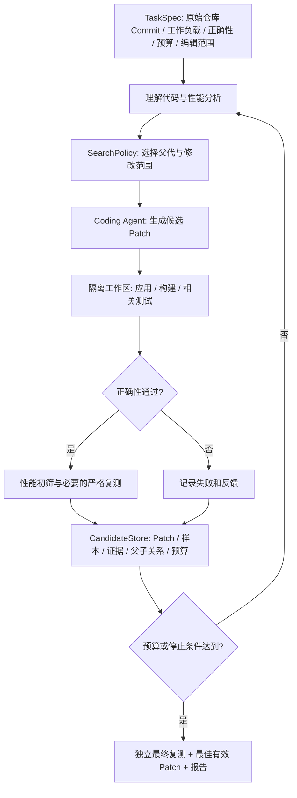

# 从四篇论文到自动代码性能优化 Agent：统一架构、完整流程与迭代开发路线（v1）

> **归档位置**：`跨论文综合/四论文到Agent_完整工作流与迭代开发路线_v1.md`  
> **整理日期**：2026-11-10  
> **性质**：研究规划与工程架构建议，不是已实现功能或已验证创新点。  
> **阅读顺序**：建议先读本篇第 1—7 节，再读《性能反馈与多候选搜索融合》。

## 0. 这份笔记解决什么问题

我们已精读 SWE-Perf、PerfAgent、ShinkaEvolve、AlphaEvolve，却不能把四篇当作四套彼此孤立的软件。它们覆盖的是一个完整代码优化系统的不同层：**可信评价、运行证据、候选搜索、搜索与评价资源组织**。

我们研究的目标不是复刻全部论文，也不是从零训练大模型，而是构建一个**可验证、可复现、可替换策略、可做公平对照实验**的自主代码性能优化研究系统。ParaLedger 是未来重要应用场景，不是唯一目标。

## 1. 四篇论文究竟做了什么

| 论文 | 论文的主要产出 | 是否属于新优化系统 | 给我们的贡献 | 不应误解为 |
|---|---|---|---|---|
| SWE-Perf | 140 个真实仓库级优化任务、评测环境与方法对照 | 主要是 Benchmark；评估现有 LLM/Agent，不以新优化 Agent 为核心贡献 | 任务数据、Patch、正确性、配对计时与统计评价 | 做好 Benchmark 就有了自动优化 Agent |
| PerfAgent | 基于现有 Coding Agent 的 Profiler 引导与多轮验证反馈工作流 | 是：外层控制器增强现有 Agent | 热点证据、逐轮验证、Best Valid Patch、预算与反投机 | 只是给模型一句“请用 Profiler” |
| ShinkaEvolve | 程序档案库、父代采样、新颖性过滤、模型选择 | 是：进化搜索框架 | 多候选、多分支、搜索多样性和样本效率 | 永远选择当前最优代码继续改 |
| AlphaEvolve | 数据库、提示采样、LLM 代码变异、级联评价、异步执行 | 是：更通用的算法发现系统 | 历史上下文、跨组件修改、分层评价、搜索资源组织 | 所有任务的得分都等于运行时间加速 |

### 1.1 为什么论文要比较各种方法？

- **主实验**：完整方法与已有方法相比是否有效。
- **消融实验**：去掉一个模块后是否退化，试图解释机制贡献。
- **预算/扩展实验**：提高候选数、模型规模或运行预算时，收益如何变化。
- **案例分析**：解释优化为什么生效，但单个案例不能替代系统性结论。

不能直接横向比较四篇论文报告的百分数：SWE-Perf 的 Performance、PerfAgent 的 Opt@1、ShinkaEvolve 的圆排布得分、AlphaEvolve 的资源回收率属于不同量纲。

## 2. 把四篇论文放进一张 Agent 系统图



说明：这是一张**研究设计综合图**，不是某篇论文的原图。各层归属：

| 层 | 最初应有什么 | 重点参考 |
|---|---|---|
| TaskSpec | 项目版本、任务 ID、允许编辑范围、测试命令、预算 | SWE-Perf |
| Analyzer / Profiler | 源码、调用上下文；后续接入结构化热点 | PerfAgent |
| SearchPolicy | V1 只选择原始版；后续最优候选或加权父代 | ShinkaEvolve、AlphaEvolve |
| Coding Agent | 复用现有 LLM/Coding Agent 的修改能力 | 通用 Coding Agent |
| Sandbox 与 Verifier | 独立构建、测试与测量 | SWE-Perf |
| CandidateStore | 每轮 Patch、测试结果、父子关系、成本 | PerfAgent、ShinkaEvolve |
| Controller | 循环、预算、回滚、停止；后续动态分配资源 | PerfAgent、AlphaEvolve |

**原则**：真实性能和正确性由外部测试系统判断，不能由生成 Patch 的 LLM 自己宣告通过；候选状态必须可追踪；评价器尽量保持稳定，以便对比不同搜索策略。

## 3. 走一个完整的代码优化实例

以下是教学构造的情景，并非本项目实验结果。目标是优化真实代码仓库的数据处理函数，保持输出一致。

### 3.1 原始程序及基线

输入任务包括：原始 Git Commit、依赖环境、测试工作负载、正确性断言、允许修改的代码区域和最大预算。独立执行原始版，得到重复测量的运行时间分布；假设均值约 **100 ms**。同时保存硬件/系统版本、原始样本和构建日志。

### 3.2 第一轮：One-shot

Coding Agent 阅读源代码，认为某个循环重复创建临时对象，输出 Patch A。评价器在隔离工作区应用该 Patch：

- 应用和构建成功；
- 相关正确性测试通过；
- 性能初测约 92 ms，严格复测仍有收益；
- 保存代码差异、测试样本和成本。

这已经是最小的 Agent 闭环：**任务输入 → 一次代码修改 → 外部验证 → 报告**，并不需要先实现复杂进化系统。

### 3.3 第二轮：PerfAgent 风格多轮反馈

系统把测试反馈送回 Agent，继续生成 Patch B，假设运行时间改善到 85 ms；第三次尝试变成 88 ms。控制器保留 **85 ms 的正确候选**，不保留最后一个较差的版本。

随后可加入 Profiler：向模型提供真实调用路径、热点占比、Self/Total Time 和定位可信度。Profiler 证据不能替代正确性测试或最终复测。

### 3.4 第三轮：ShinkaEvolve 风格多候选

如果始终只沿 85 ms 的候选修改，可能陷入局部最优。候选库可以同时保留另一个正确但当前仅有 95 ms 的数据布局方案，继续优化后可能得到 78 ms。此时引入父代采样、搜索分支与多样性评价。

**提示**：反馈循环与多候选并不应当永久拆成两个互不通信的 Agent。每个候选都可有自己的分析证据和局部迭代历史，统一的控制器负责决定下一步选哪条分支。详见第二份独立文档。

### 3.5 第四轮：AlphaEvolve 风格的评价资源分配

当候选增多时，昂贵的完整测试不能对明显无效的每份 Patch 全做一遍。可以采用分层门禁：

```text
Patch 生成
  → 补丁可应用 / 构建
  → 正确性快速门禁
  → 短时性能初筛
  → 值得保留的候选进入严格复测
  → 独立最终验证
```

这种级联必须防止“初筛错误地淘汰真正有价值的候选”，而且不得让模型修改正式评价脚本获取虚高收益。

## 4. 最小系统应该由哪些模块组成

最初尽量只有五个稳定模块，后续再将策略抽象出来：

| 模块 | 最小职责 | 必须输出 |
|---|---|---|
| TaskManager | 准备固定代码版本、测试任务与编辑权限 | `task_id`, `base_commit`, `workload_id` |
| CodingAgentAdapter | 读取上下文、返回 Patch | `candidate_id`, `patch_file`, `model_usage` |
| ExecutionSandbox | 提供独立工作区、构建和命令执行 | 应用/构建日志、退出状态、环境信息 |
| Evaluator | 正确性、配对测量、统计结果 | 测试状态、全部耗时样本、有效收益估计 |
| ExperimentStore | 保存候选、日志、版本和成本 | 可恢复的实验记录、最佳有效候选引用 |

开始时 SearchPolicy 可以只是固定策略，Controller 可以只允许一次修改。不要一开始做多模型 Bandit、分布式多 Island 和复杂自适应调度。

## 5. 可逐步实施的 V0—V5 版本路线

| 版本 | 新增能力 | 最小验收 | 与谁比较 |
|---|---|---|---|
| **V0** | 不接 LLM 的评价底座 | 人工 Patch 能被正确应用、验证、测量、回滚和记录 | 预设正确/错误/退化样例 |
| **V1** | One-shot Coding Agent | 在选定任务上完成一次自动修改并生成真实报告 | 原始代码、人工已知 Patch；作为后续基线 |
| **V2** | 多轮验证反馈、最佳有效候选 | 每轮记录；错误/退化不覆盖最佳版本；预算停止有效 | V1；同预算 Independent Best-of-N |
| **V3** | Profiler Adapter 与热点反馈 | 能获取可追溯热点；反馈不凭空编造；最终复测 | V2 无 Profiler vs V3 有 Profiler |
| **V4** | 候选档案库、父代策略、多分支 | 可从非最佳候选继续；保留父子谱系 | Best-of-N / Hill Climbing / Population |
| **V5** | 预算感知调度、去重、级联与受控编辑扩展 | 每个机制可开关、日志可审计 | 独立消融及组合消融 |

**开发关口**：V0 不可靠，不应启动大规模 V1；V1 不稳定，不应追加 V2—V5；V3/V4 先独立验证，再做融合的因子实验。版本号代表研究平台能力演进，不等于对应论文已经确定的创新点。

## 6. 如何公平地比较策略

### 6.1 第一轮最重要的实验

- V1 One-shot：一次修改。
- V2 Feedback：按相同任务、预算做多轮修改。
- Best-of-N：从原始版独立生成若干候选，做合理可复现的候选选择。
- V3 Profiler-Feedback：与 V2 相同控制器，增加真实热点证据。
- V4 Population：在其他配置相同的前提下替换父代选择方式。

### 6.2 两种预算需要分别报告

1. **相同正式候选评价次数**：比较候选样本效率。
2. **相同端到端资源预算**：把 LLM Token/费用、Profiler 开销、构建与测试时间都计入。

两种预算不能混同。统一模型、代码版本、评价器、任务集、正确性规则；保存随机种子与多次独立试验结果。

### 6.3 指标至少包括

- Patch Apply / Build / Correctness；
- 最佳有效 Patch 的独立复测性能收益（注明统计规则与区间）；
- 全任务成功率、正确任务条件收益及正确任务数（不能混成一个指标）；
- Cost-to-Target、运行费用与总耗时；
- 失败类型、无效候选率、重复候选率；
- 冷启动/热启动或输入泛化检查，避免缓存型 Benchmark 投机。

## 7. 结果解释、研究边界和下一步

### 7.1 哪些是工程基础，哪些才可能形成研究方法

工程基础：隔离环境、构建、正确性、重复计时、候选持久化、预算日志。研究方法：性能证据的表达、何时 Profiling、父代选择、局部迭代/跨分支切换、代码编辑范围与评测预算分配。

### 7.2 创新性判断的三道门槛

1. **文献门槛**：是否已有相同策略或近似机制？不能把“将两篇论文的模块连在一起”直接算成创新。
2. **因果门槛**：通过消融和预算匹配，能否确认提出的决策策略本身有效？
3. **可信门槛**：收益是否通过独立正确性和性能复测，而不是利用评测漏洞？

### 7.3 与 Codex 的工作分工

Codex 当前先读仓库并审查 V0/V1 的现状，输出代码依据、缺口和最小闭环设计；正式开发必须另行授权。我们负责文献查新、机制假设、对照实验设计和结果解释。ParaLedger 等复杂应用应在评价底座稳定后再进入。

## 参考论文（原始研究）

1. SWE-Perf, https://arxiv.org/abs/2507.12415  
2. PerfAgent, https://arxiv.org/abs/2607.19653  
3. ShinkaEvolve, https://arxiv.org/abs/2509.19349  
4. AlphaEvolve, https://arxiv.org/abs/2506.13131
