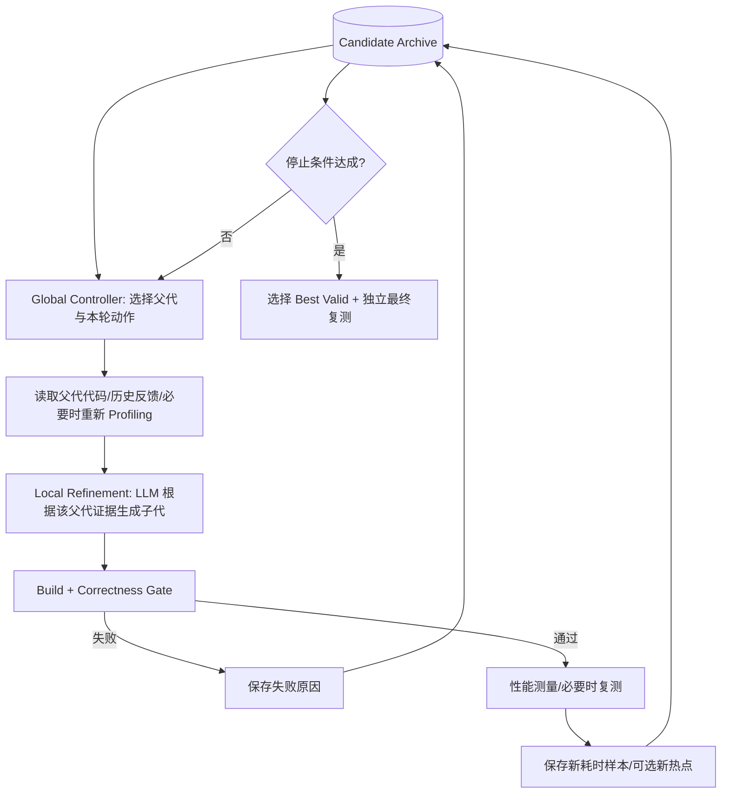

# 性能反馈与多候选搜索的统一：系统架构、决策问题与潜在创新方向（研究假设 v1）

> **归档位置**：`跨论文综合/性能反馈与多候选搜索融合_统一架构与研究假设_v1.md`  
> **整理日期**：2026-11-10  
> **性质**：研究假设和可实验验证方案，**不代表已经查新确认的原创方法，也不代表已经实现**。  
> **建议先读**：《四论文到 Agent 完整工作流与迭代开发路线》的第 3、5、6 节。

## 1. 问题源于什么“割裂感”

此前的教学路径是：

- PerfAgent：原始程序 → Profiler → Patch1 → 测试 → Profiler → Patch2 → ……，强调**当前修改的性能证据与多轮细化**。
- ShinkaEvolve：候选池 → 选择父代 → 变异 → 测试 → 更新候选池，强调**不同候选之间的分支搜索**。

二者看似冲突：一个一直优化“当前程序”，另一个可以突然切换到“其他程序”。但二者本质上控制不同层面的决策：

| 决策 | 关键问题 | 典型依据 |
|---|---|---|
| **分支内决策** | 已选中程序 P 后，下一处瓶颈是什么？怎样修改？ | Profiler 调用栈、性能变化、失败日志 |
| **分支间决策** | 下一轮应继续 P，还是选另一个候选 Q？ | 当前收益、历史尝试次数、多样性、预算 |
| **评价资源决策** | 应做快速初筛、重新 Profiling，还是严格复测？ | 测试成本、测量噪声、证据新鲜度、任务风险 |

**重要澄清**：PerfAgent 并非只会做“无反馈的单链”，ShinkaEvolve 也不是“完全没有评价反馈”。这里是为了研究设计而突出两者各自强调的机制；不应将这张分类当作它们的全部能力。

## 2. 融合不能简单采用“先跑完整 PerfAgent，再运行 ShinkaEvolve”

简单串联可能引起四个问题：

1. **重复消耗预算**：后面的进化过程重新评估前面已有的局部修改。
2. **信息丢失**：候选 P 的热点、失败原因和正确性边界没有随候选一起进入搜索库。
3. **反馈错配**：把 P 的 Profiler 证据无差别地传给结构不同的 Q，可能误导模型。
4. **控制策略无法协同**：没有一个模块决定何时深入当前路线、何时探索其他路线。

建议采用**一个候选档案库 + 一个统一调度器 + 可插拔的分析器与评价器**。不是两个独立的 Agent 互相调用，而是同一个优化过程里存在**局部反馈环**和**全局候选环**。

## 3. 统一系统的两层循环



### 3.1 局部反馈环（Local Refinement）

1. 选择父代 P，并恢复**P 对应的代码版本**；
2. 读取 P 的执行证据：原始耗时样本、调用栈、热点、最近修改；
3. Coding Agent 生成一个新 Patch；
4. 在独立工作区应用、构建、验证和测量；
5. 如正确且有收益，保存为子代 P′，并将新测量关联到 P′；
6. 控制器决定是否继续同一分支。

**不能假定每轮必需完整 Profiling**：采样有成本；可以在热点迁移、结构性修改或反馈不足时再采样，但何时采样是待实验变量。

### 3.2 全局候选环（Global Search）

CandidateStore 保留 P、Q、R 等多个代码版本及其父子关系。每一轮根据策略选一个父代，而不是只看当前最小平均耗时：

- **Best-Only**：选择当前验证后的最佳候选（Hill Climbing 基线）。
- **Uniform**：在符合正确性要求的候选中随机选择。
- **Fitness + Exploration**：综合得分与历史子代数，参考 ShinkaEvolve。
- **Evidence/Budget-Aware**（待研究）：在前述信号之外，额外考虑证据不确定性、连续无改善次数和剩余预算。

后续可研究 Crossover，但**先不让两个任意 Patch 随意拼接**：不同代码基线和依赖修改可能产生冲突，必须重新完整验证。

### 3.3 任务示例：为什么次优父代可能更有价值

> 以下耗时全为教学假设，不能当作实验结论。

```text
P0  100 ms
├── P1   85 ms  [循环微优化]
│   └── P2   72 ms [沿同一路线继续细化]
└── P3   93 ms  [数据布局重构，初期收益一般]
    └── P4   60 ms [该分支进一步去除复制开销]
```

一味 Best-Only 可能错过 P3；完全随机又可能浪费大量时间。统一控制器应当利用 P3 的有效性、修改方向、新瓶颈和探索程度，适度保留机会。性能证据始终与**具体候选版本和工作负载**绑定。

## 4. 一个候选究竟要保存哪些信息

推荐的最小数据记录（建议接口，不是现成的论文官方格式）：

```yaml
task_id: repo-task-001
candidate_id: P4
parent_id: P3
base_commit: <exact git commit>
patch_hash: <sha256>
source_revision: <immutable snapshot>
status: valid  # generated / apply_failed / build_failed / incorrect / valid
correctness:
  suite_id: test-suite-v1
  passed: true
performance:
  workload_id: workload-v2
  baseline_samples_ms: [100.2, 99.7, 100.4]
  candidate_samples_ms: [60.3, 60.6, 59.9]
  estimator: <method and parameters>
profiler:
  artifact_path: <local artifact>
  sampled_revision: P4
  workload_id: workload-v2
  tool_version: <version>
search:
  parent_policy: weighted
  local_feedback_type: structured_hotspots
  seed: 42
cost:
  model_tokens: <integer>
  eval_walltime_s: <number>
  profiler_walltime_s: <number>
```

在实际数据中不能混淆：**候选的运行时间测量、生成候选所消耗的时间、Profiler 自身开销**。Profiler 摘要中的“推测瓶颈”也应与观测到的热点事实分开存储。

## 5. 统一控制器该做哪些动作

与其先想一个复杂的评分公式，不如先定义动作集合：

| 动作 | 说明 | 触发依据示例 |
|---|---|---|
| `REFINE(P)` | 沿 P 分支继续变异 | P 最近有效、热点明确、仍有改进空间 |
| `SWITCH_PARENT(Q)` | 切换到 Q 作为父代 | 当前分支停滞；Q 代表不同且未充分探索的路线 |
| `REPROFILE(P)` | 为 P 收集新性能证据 | 结构性修改、热点迁移或证据过期 |
| `VERIFY(P)` | 对有前景的候选严格复测 | 初筛明显改善但波动较大 |
| `STOP` | 退出搜索 | 预算耗尽、收益连续停滞或达到目标 |

### 5.1 最初的确定性策略（工程基线）

可以不使用复杂学习算法：

1. 设置 `max_candidates`、`max_walltime`、`max_model_cost`；
2. 在每个父代最多连续细化 K 次后允许切换；
3. 保存所有有明确状态的候选、独立维护全局最佳正确版本；
4. 只在热点发生迁移或需要解释时采样；
5. 达到预算后对最佳版本做独立复测。

这是一个可运行的基线策略，**不能将其描述为创新算法**。

### 5.2 更进一步的研究性调度

考虑 `expected improvement`、`exploration deficit`、`profile uncertainty`、`remaining budget` 等信号，学习或估计动作价值。这里存在大量已有 bandit、Bayesian optimization、evolutionary computation 和 scheduling 相关研究，需要先进行系统查新。

注意：**比已有方法更复杂不等于更好**；调度器多一次模型推理或重新 Profiling，都要计入预算。

## 6. 真正可能成立的研究问题（待文献查新）

| 研究问题 | 对照设计 | 成功证据 | 风险 |
|---|---|---|---|
| RQ1：性能证据能否提升多候选搜索？ | Population 无/有 Profiler | 在固定成本下提高验证后的最佳收益 | 仅因成本更多而变好 |
| RQ2：何时切换分支更合适？ | 固定切换、只选最优、加权选择、证据感知选择 | 改善 Cost-to-Target 或最终收益 | 策略可能只对一类任务有效 |
| RQ3：何时重新 Profiling？ | 每轮、固定频率、按需、从不 | 保持或提升收益并降低采样开销 | 证据过期导致错误决策 |
| RQ4：多分支是否改善跨模块优化？ | 单函数、关联函数、允许受控跨模块 | 提高复杂任务的正确加速成功率 | 编辑范围扩大引入语义回归 |
| RQ5：是否能减少重复评测？ | 无去重、代码相似度、语义与证据联合过滤 | 相同总成本下找到更好的正确候选 | 错误过滤出有价值的小改动 |

**创新性门槛**：提出有别于现有工作的明确决策依据；验证该机制本身的作用；证明收益具有可复现性和成本合理性。单纯把 PerfAgent 和 ShinkaEvolve 串起来，不应直接宣称创新。

## 7. 必须先完成的实验矩阵

### 7.1 第一组：2×2 因子实验

| 搜索策略 | 只有计时/测试反馈 | 加入 Profiler 证据 |
|---|---|---|
| 单路径反馈 | A | B |
| 多候选搜索 | C | D |

需要分别分析主效应和交互效应。如果用同一指标的四组均值表示，交互效应可写为：

\[
I=(D-C)-(B-A)
\]

若 `I > 0`，代表该组实验在此指标上存在正向的加性交互估计；但只有加上重复实验、置信区间和其他控制之后，才有资格进一步讨论可信性。

### 7.2 第二组：搜索决策消融

在 D 的基础上依次替换一项决策：

- 父代策略：Best-Only / Random / Weighted / Evidence-aware；
- Profiling：Never / Always / Fixed-frequency / On-demand；
- 预算策略：固定轮数 / 达到目标后停止 / 停滞判断；
- 记录 Cost-to-Target、正确性通过率、最终可信收益和无效候选比例。

### 7.3 两种预算与一个独立评测要求

- **同正式评测次数**：检验样本效率。
- **同总资源预算**：模型、Profiler、编译测试、复测的总成本可比。
- **独立最终评测**：不要以搜索时最乐观的单次计时作为最终论文结果；设置未用于搜索的输入规模/数据、独立复测或其他合理的防过拟合机制。

其他控制变量：统一任务、模型版本、硬件和评价器、允许编辑范围、随机种子；多次实验报告均值、方差及失败原因。

## 8. 风险、约束与工程边界

1. **正确性门禁不可放松**：性能更快但错误的代码不是有效候选。
2. **工作空间隔离**：父代/子代版本必须可恢复；不能不同候选共享未清理的文件状态。
3. **Profiler 证据绑定版本**：同名函数在不同候选中可能行为不同。
4. **评测器与候选隔离**：阻止修改测试脚本、识别评测状态、缓存固定输入进行投机。
5. **噪声管理**：同一候选多次执行可能波动；不能直接按单次最快值选父代。
6. **语言适配**：Python 可使用 py-spy，C++/RDMA 应考虑其他适配器；不应把 py-spy 写死为系统必备依赖。
7. **复杂系统扩展**：ParaLedger 等分布式程序还需要一致性、TPS、尾延迟与通信指标；不能用单个 Python 测试的收益代表整个系统。

## 9. 建议阶段与 Codex 交接时机

- **现在**：完成当前工程的 Phase A 审查，确认 V0/V1 真实状况。
- **基础验证**：V0 评价底座 → V1 One-shot → V2 反馈闭环。
- **研究对照**：V3 Profiler vs 无 Profiler；V4 Population vs Best-Only / Best-of-N。
- **融合实验**：只有在前述对照稳定后，再实现 `Evidence-aware Search Controller` 并做 2×2 与调度消融。
- **最后**：决定是否扩展到异步并行搜索、多模型 Bandit、复杂 C++/分布式场景。

暂不授权 Codex 直接构建大型进化 Agent，也不要求它自行决定创新点。

## 参考来源

- PerfAgent: https://arxiv.org/abs/2607.19653
- ShinkaEvolve: https://arxiv.org/abs/2509.19349
- SWE-Perf: https://arxiv.org/abs/2507.12415
- AlphaEvolve: https://arxiv.org/abs/2506.13131
